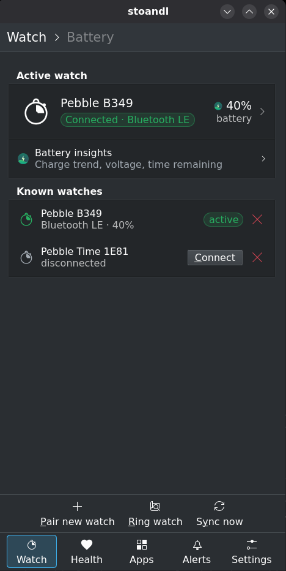
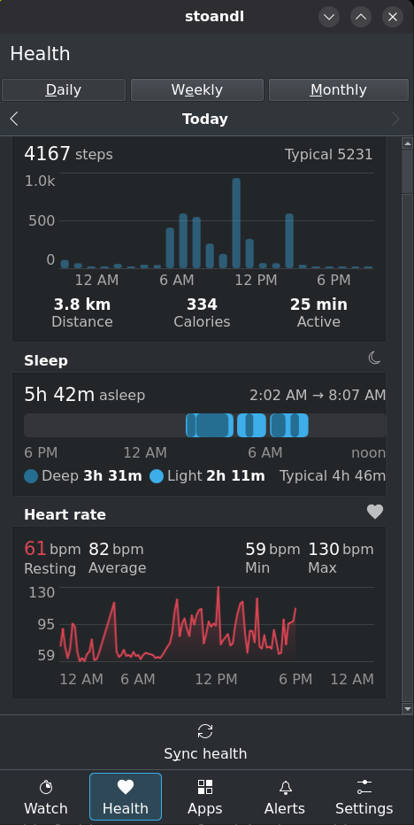
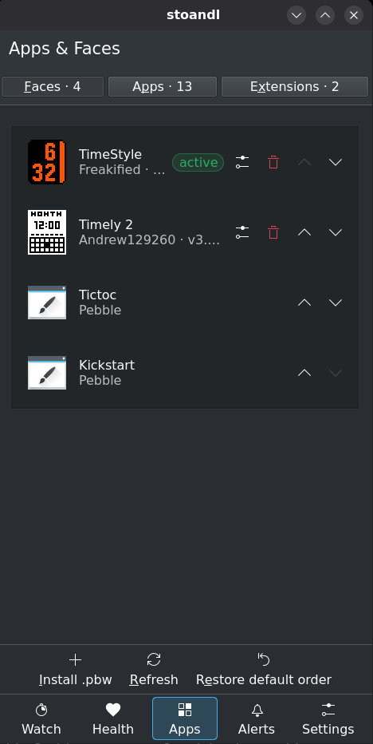
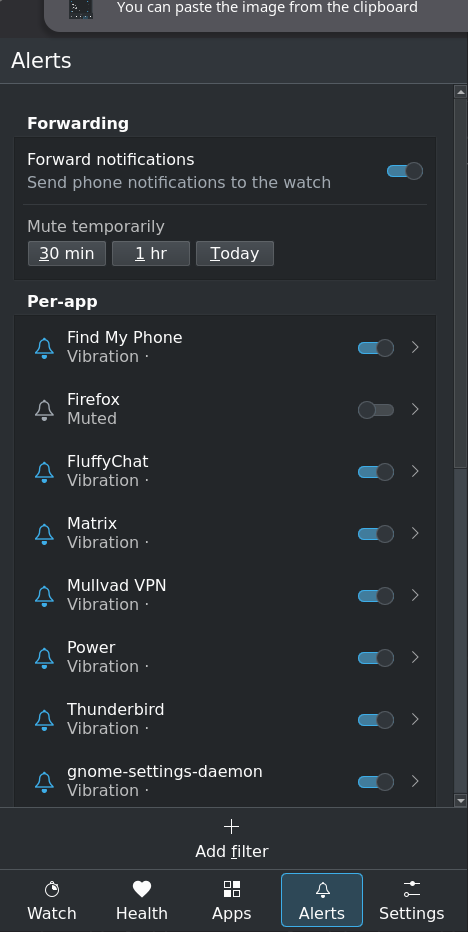
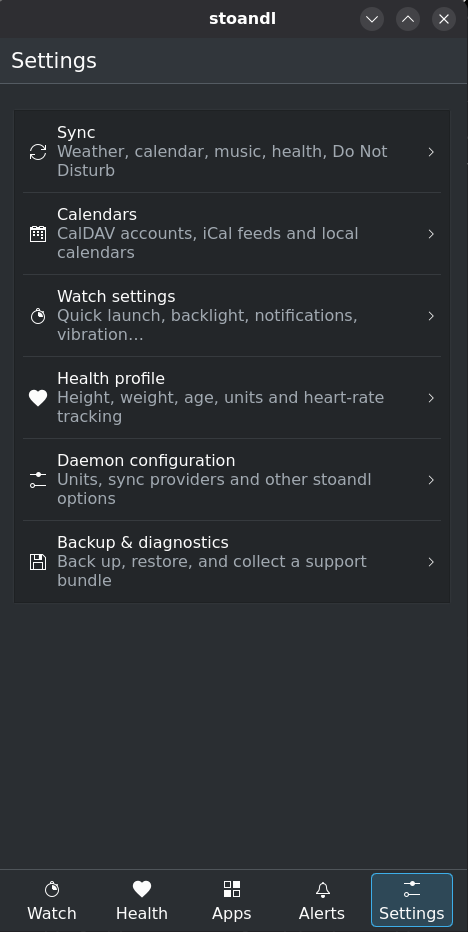
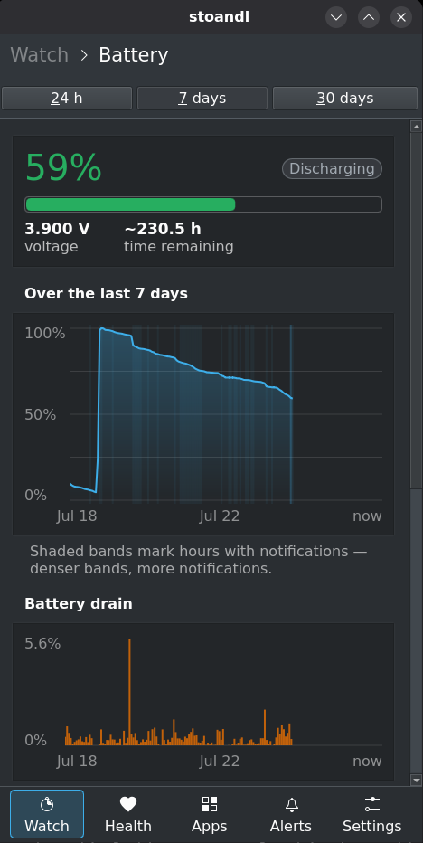

<p align="center"></p>

# stoandl-gui

Desktop / mobile front-end for the **stoandl** Pebble companion daemon. Convergent:
Plasma Mobile + phosh + desktop.

It is built with **Kirigami** (Qt 6 / QML, KDE) in `kirigami/`: app id
`de.yoxcu.stoandl.gui`, binary `stoandl-gui`, launcher name "stoandl".

It speaks the daemon's `de.yoxcu.stoandl.Control` D-Bus contract (session bus, path
`/de/yoxcu/stoandl`) and is a thin client of the (separately installed) daemon —
no code is shared with it. Full contract: the daemon repo's `docs/dbus-interface.md`
([`docs/dbus-interface.md`](docs/dbus-interface.md) links to it).

## Layout

```
kirigami/    Qt/QML front-end (CMakeLists.txt, src/, qml/)
data/        desktop integration — .desktop / .metainfo / flatpak manifest, and
             the hicolor icon tree (de.yoxcu.stoandl.gui.*)
packaging/   APKBUILD (kirigami/) + the signing key (keys/)
.github/     CI: one workflow builds the flatpak and the apk
tools/       mock daemon + the run-with-mock launcher
```

## Screenshots

<table>
  <tr>
    <td align="center" width="33%"><br><sub><b>Watch</b> — pairing, firmware, battery</sub></td>
    <td align="center" width="33%"><br><sub><b>Health</b> — steps, sleep, heart rate</sub></td>
    <td align="center" width="33%"><br><sub><b>Apps</b> — faces, apps, extensions</sub></td>
  </tr>
  <tr>
    <td align="center" width="33%"><br><sub><b>Alerts</b> — per-app mute, filters</sub></td>
    <td align="center" width="33%"><br><sub><b>Settings</b> — sync, calendars, config</sub></td>
    <td align="center" width="33%"><br><sub><b>Battery insights</b> — charge, drain, power</sub></td>
  </tr>
</table>

## Build

Qt6 (Core/Gui/Widgets/Qml/Quick/DBus) plus the Kirigami and
KirigamiAddons **runtime QML modules** and a QtQuick Controls style
(`qqc2-desktop-style`):

```sh
cmake -S kirigami -B build -G Ninja
cmake --build build            # → ./build/stoandl-gui
```

In this dev container the Qt deps are installed via `.container/Dockerfile` —
rebuild/restart the container first. Desktop integration (`.desktop` launcher,
AppStream metainfo, hicolor icon theme) lives in `data/` and installs to `<datadir>`;
see `data/README.md`.

## Run

The daemon is **not** D-Bus-activated; start it first (or let the in-app button do it):

```sh
systemctl --user start stoandl     # optional — the GUI offers this too
./build/stoandl-gui
```

Headless smoke test (no live UI): `QT_QPA_PLATFORM=offscreen ./build/stoandl-gui`.

## Testing without the real daemon (mock)

`tools/mock_stoandl.py` is a stateful stand-in for `de.yoxcu.stoandl.Control` that
implements the **full surface the GUI uses**. The launcher spins up an ephemeral
session bus, starts the mock on it, then launches the GUI:

```sh
tools/run-with-mock.sh                            # desktop
QT_QPA_PLATFORM=offscreen tools/run-with-mock.sh  # headless smoke test
tools/run-with-mock.sh --mock-only                 # just the mock (Ctrl-C to stop)
```

Requires `dbus`, `python3-dbus`, `python3-gi` (installed via `.container/Dockerfile`).

## Releases

CI is `.github/workflows/release.yml`: the Flatpak builds on every push/PR (the CI
gate — stock Ubuntu's Qt is too old to build natively), and pushing a `v*` tag
publishes a GitHub Release with:

- a **`.flatpak` bundle** — `de.yoxcu.stoandl.gui.flatpak` (KDE runtime),
- an **aarch64 pmOS `.apk`** — `stoandl-gui`,
- the **source tarball** (`stoandl-gui-<ver>.tar.gz`) that feeds
  `packaging/kirigami/APKBUILD`, and
- an auto-generated changelog (`cliff.toml`, from Conventional Commit messages).

### Installing the postmarketOS `.apk`

A tagged release also ships the public signing key (`mick@yoxcu.de-*.rsa.pub`). Trust
it once and `apk add` installs — and every future release — without `--allow-untrusted`:

```sh
# from the release page, download the .apk and the matching .rsa.pub, then:
doas cp mick@yoxcu.de-*.rsa.pub /etc/apk/keys/   # trust the signing key (once)
doas apk add ./stoandl-gui-*.apk
```

(Or skip the key with `doas apk add --allow-untrusted ./...apk`.)

### Installing / testing a Flatpak build

A `.flatpak` bundle isn't runnable directly — you `flatpak install` it first (a fast
import, not a rebuild):

```sh
# grab a bundle: a CI build artifact (any push) …
gh run download -R yoxcu/stoandl-gui -n flatpak-bundle-kirigami
# … or a tagged release asset
gh release download -R yoxcu/stoandl-gui -p '*.flatpak'

flatpak remote-add --if-not-exists --user flathub https://flathub.org/repo/flathub.flatpakrepo
flatpak install --user de.yoxcu.stoandl.gui.flatpak      # org.kde.Platform
flatpak run de.yoxcu.stoandl.gui
```

Start the daemon on the host first (`systemctl --user start stoandl`) — the sandboxed
GUI reaches it over the session bus. Sandbox limits: backup/restore/support (which
shell out to the `stoandl` CLI) and the in-app "start daemon" button don't work inside
the Flatpak; the D-Bus features do. **For day-to-day development, skip the Flatpak** and
build + run natively.
